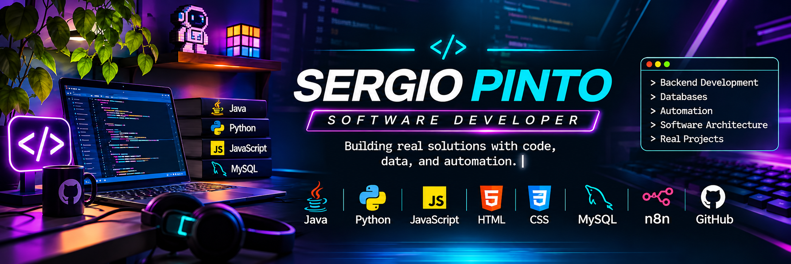

<p align="center">
  
</p>

<!-- ================================================= -->
<!--              SERGIO PINTO - PROFILE               -->
<!-- ================================================= -->

<div align="center">


<br/>

<a href="https://github.com/Spinto-cloud">

</a>
<a href="https://www.linkedin.com/in/sergio-andr%C3%A9s-pinto-duque-3020506b/">

</a>


</div>

---

<h2 align="center">
  
</h2>

```java
public class SergioPinto {

    String name = "Sergio Pinto";
    String role = "Software Development Student";
    String institution = "Campuslands - K4";
    String location = "Colombia";

    String[] languages = {
        "Java",
        "Python",
        "JavaScript",
        "HTML",
        "CSS",
        "SQL"
    };

    String[] interests = {
        "Backend Development",
        "Software Architecture",
        "Database Design",
        "Automation",
        "Problem Solving"
    };

    public void introduce() {
        System.out.println(
            "Welcome to my developer portfolio!"
        );
    }
}
```

I am a software development student passionate about building practical solutions through programming, database management, and workflow automation.

I enjoy learning new technologies, solving problems, and developing projects that combine software architecture, backend logic, and user-oriented functionality.

---

<h2 align="center">
  
</h2>

<h3 align="center">💻 PROGRAMMING LANGUAGES</h3>

<div align="center">


</div>

<h3 align="center">🌐 FRONTEND DEVELOPMENT</h3>

<div align="center">


</div>

<h3 align="center">🗄️ DATABASES & DEVELOPMENT TOOLS</h3>

<div align="center">


</div>

<h3 align="center">⚙️ AUTOMATION & INTEGRATIONS</h3>

<div align="center">


</div>

<h3 align="center">🧠 SOFTWARE ENGINEERING</h3>

<div align="center">


</div>

| Technical Area | Technologies |
|---|---|
| Backend | Java, Python |
| Frontend | HTML5, CSS3, JavaScript |
| Databases | MySQL |
| Automation | n8n, Telegram API |
| Architecture | MVC, SOLID, DAO, Repository, Factory |
| Programming | OOP, Collections, Streams, Lambda |
| Persistence | JDBC, MySQL, LocalStorage, TXT |
| Version Control | Git, GitHub |

---

<h2 align="center">
  
</h2>

<div align="center">


</div>

---

### <span style="color:#A855F7">01 / GESTIÓN DE HERRAMIENTAS SP</span>


A tool management system designed for a residential community, allowing neighbors and administrators to organize shared tools, manage loans, and monitor inventory.

**⚡ Main Features**

- Tool registration, consultation, updating, and deletion.
- Neighbor and administrator management.
- Tool loan and return management.
- Inventory and availability control.
- Loan history and overdue loan tracking.
- Low-stock reports and usage statistics.
- User roles and administrative permissions.

**🧠 Technical Concepts**

Python · OOP · CRUD Operations · Data Validation · Collections · Inventory Management

<div align="right">

[](https://github.com/Spinto-cloud/gestionar_herramientas_sp.git)

</div>

---

### <span style="color:#FF00A8">02 / PATITAS FELICES</span>


A static website concept for an animal rescue and adoption foundation, focused on presenting animals available for adoption and promoting responsible pet care.

**⚡ Main Features**

- Home page with promotional banner and call to action.
- Mission and vision sections.
- Image gallery with CSS animations.
- Animal catalog with adoption information.
- Individual animal profile page.
- Contact form with required fields and visual validation states.
- Responsive layout for desktop and mobile devices.

**🧠 Technical Concepts**

Semantic HTML5 · CSS3 · Flexbox · CSS Grid · Media Queries · Keyframe Animations · Pseudo-classes

<div align="right">

[](https://github.com/Spinto-cloud/patitasfelices_proyectosp.git)

</div>

---

### <span style="color:#00E5FF">03 / RUTAS SEGURAS KIDS</span>


A school transportation route management application developed for Rutas Seguras Kids. The application allows users to organize routes and students through an interactive web interface.

**⚡ Main Features**

- Create, edit, and delete school routes.
- Add and display students assigned to each route.
- Weather information through the wttr.in public API.
- LocalStorage persistence after browser reload.
- Responsive interface for desktop, tablet, and mobile devices.
- Reusable Web Components.
- Shadow DOM for component encapsulation.
- Custom events using CustomEvent.

**🧠 Technical Concepts**

Vanilla JavaScript · DOM Manipulation · Fetch API · Async/Await · LocalStorage · Web Components · Shadow DOM · Custom Events · Modular Architecture

<div align="right">

[](https://github.com/Spinto-cloud/proyectojsrutassegurasSP.git)

</div>

---

### <span style="color:#FF00A8">04 / DELIVERYBOT</span>


An automated ordering system designed for cafeterias in offices, universities, and workplaces. It allows users to place food orders through Telegram while synchronizing orders, inventory, and customer information with Google Sheets.

**⚡ Main Features**

- Telegram bot registration and interaction.
- Digital menu organized by categories.
- Shopping cart management.
- Order confirmation and total calculation.
- Automatic stock validation and inventory updates.
- Unique order identification.
- Order status tracking and notifications.
- Order history consultation.
- Kitchen order management.
- Customer loyalty points.
- Automated daily sales reports.

**⚙️ Workflow Architecture**

| Workflow | Responsibility |
|---|---|
| `01_DeliveryBot_Pedidos_Estados.json` | Order management, customer sessions, inventory, and order status |
| `02_DeliveryBot_Reporte_Diario.json` | Scheduled daily sales reporting at 8:00 PM (Bogotá time) |

**🧠 Technical Concepts**

Workflow Automation · n8n · Telegram Bot API · Google Sheets Integration · JavaScript · JSON · API Integration · Business Logic · Scheduled Workflows

<div align="right">

[](https://github.com/Spinto-cloud/SPdeliverybot.git)

</div>

---

### <span style="color:#39FF14">05 / PIZZERÍA DON PICCOLO</span>


A relational database solution designed to manage the main operations of a pizzeria, including customers, products, ingredients, orders, and home deliveries.

**⚡ Database Features**

- Customer information management.
- Pizza catalog and product availability.
- Ingredient inventory control.
- Many-to-many relationships between pizzas and ingredients.
- Order registration and detail management.
- Delivery driver and delivery management.
- Pizza price history.

**🗄️ Database Components**

- **Tables:** Relational data structure and constraints.
- **Functions:** Order total and daily net profit calculations.
- **Stored Procedures:** Delivery registration and order status updates.
- **Triggers:** Automatic ingredient stock deduction, price change history, and delivery driver availability updates.
- **Views:** Customer order summaries, delivery performance, and low-stock ingredients.

**🧠 Technical Concepts**

MySQL 8.0 · DDL · DML · DQL · JOIN · GROUP BY · HAVING · Subqueries · Aggregate Functions · Stored Procedures · Triggers · Views · Relational Modeling

<div align="right">

[](https://github.com/Spinto-cloud/proyecto_pizzeriadonpiccolo_SP.git)

</div>

---

### <span style="color:#FFB000">06 / CREDIYA SP — LOAN MANAGEMENT SYSTEM</span>


A console-based Java application developed to digitalize loan administration and payment management for a personal lending company.

The system centralizes customer and employee information, manages loans and installments, records payments, and generates portfolio reports.

**⚡ Main Features**

- Client and employee registration and management.
- Loan creation and administration.
- Automatic loan and installment calculations.
- Payment registration and payment history.
- Outstanding balance tracking.
- Identification of overdue loans and installments.
- Portfolio reports and financial summaries.
- Data persistence using MySQL, JDBC, and TXT files.

**🏗️ Architecture & Design Patterns**

| Pattern / Principle | Application |
|---|---|
| MVC | Separation of models, views, and controllers |
| DAO | Interfaces defining data access operations |
| Repository | Data persistence and retrieval |
| Factory | Centralized controller creation through ControllerFactory |
| SOLID | Modular design and separation of responsibilities |

**🧠 Technical Concepts**

Java · OOP · Encapsulation · Inheritance · Polymorphism · SOLID · Collections · Streams API · Lambda Expressions · JDBC · MySQL · File Handling · Exception Handling

**Database:** `crediya_sp_db`

<div align="right">

[](https://github.com/Spinto-cloud/proyecto_pizzeriadonpiccolo_SP.git)

</div>

---


<h2 align="center">📊 GitHub Analytics</h2>

<p align="center">
  
  
</p>

<h2 align="center">🔥 Contribution Streak</h2>

<p align="center">
  
</p>


<h2 align="center">
  
</h2>

| Engineering Area | Technologies |
|---|---|
| Backend Development | Java, Python |
| Frontend Development | HTML5, CSS3, JavaScript |
| Database Engineering | MySQL, SQL, JDBC |
| Workflow Automation | n8n, Telegram API |
| Software Architecture | MVC, SOLID, DAO, Repository, Factory |
| Programming Paradigms | OOP, Collections, Streams, Lambda |
| Data Persistence | JDBC, MySQL, LocalStorage, TXT |
| Development Tools | NetBeans, Maven, Git, GitHub |

---

<h2 align="center">
  
</h2>

<div align="center">


</div>

- Backend development and software architecture.
- Advanced Java programming.
- Database design and optimization.
- API integration and automation.
- Clean Code and software engineering best practices.

---

<h2 align="center">
  
</h2>

<div align="center">

### 💻 CODE. CREATE. INNOVATE.

**Always learning. Always building.**

<a href="https://www.linkedin.com/in/sergio-andr%C3%A9s-pinto-duque-3020506b/">

</a>

<a href="https://github.com/Spinto-cloud">

</a>

<br/><br/>


</div>
